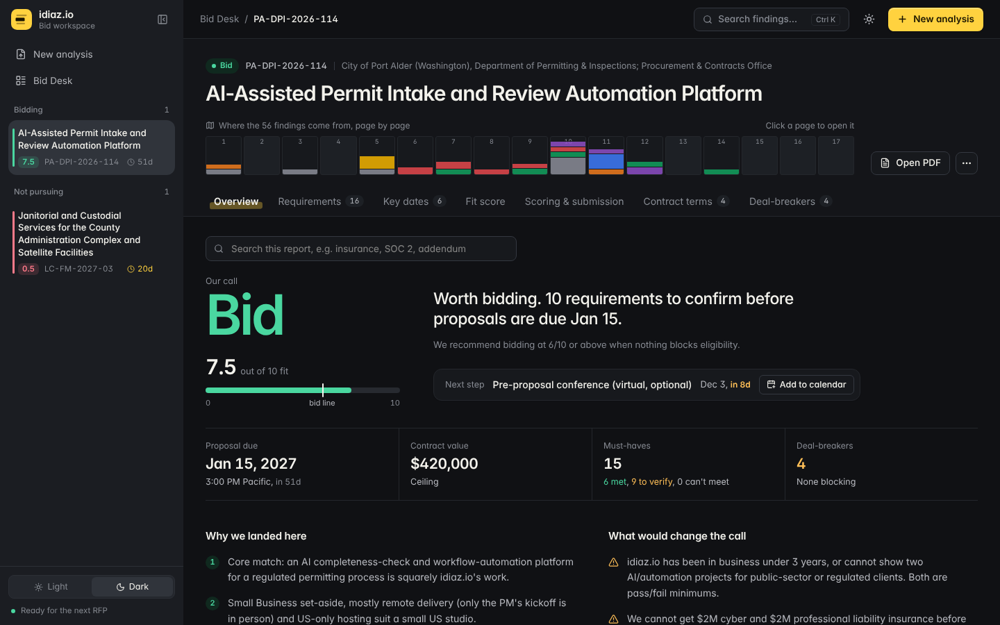

# RFP Triage Agent · idiaz.io Internship Challenge 2026

Drop in a government RFP PDF. In about a minute you get a **BID / NO_BID** call, a **0–10 fit score** against the idiaz.io profile, every key date and requirement, and a **page number plus verbatim quote** for each fact. Each quote is checked against the PDF text before you see it. The same report is available as JSON.



**Live link:** `<add your Vercel URL here>` · **Stack:** Next.js 15 (App Router, TypeScript) on Vercel Hobby + Google Gemini 3.8 Flash (free tier). No paid services, database or logins.

---

## What it returns

| Brief asks for | Where it is in the report / JSON |
|---|---|
| Summary in plain English | `summary` |
| Agency, scope, contract type & value, location, how to submit | `facts.*`, each with `value`, `status` (`stated` / `not_stated` / `ambiguous`), `note`, `evidence[]` |
| Key dates (Q&A cut-off, proposal due, site visit, work start) | `deadlines[]`: `what`, `date` (ISO), `time`, `timezone`, `mandatory`, `evidence[]`. Missing ones are always listed as "Not stated". |
| Skills, certifications, set-asides, clearances, past performance, staffing | `requirements[]`, grouped by `category`, with `mandatory` (must) vs scored |
| Fit score 0–10 with a one-line reason per factor | `fit_score`, `fit_factors[]` |
| Bid / no-bid, 3 strongest reasons, what would change its mind | `decision`, `reasons[3]`, `change_mind[]` |
| Deal-breakers and questions for the agency | `deal_breakers[]` (`blocking` / `verify`), `open_questions[]` (one click copies them as an email) |
| Flag ambiguity instead of guessing | `ambiguities[]` and `review_flags[]`, shown under "Check before you trust it" |

The top-level shape matches the brief's example (`decision`, `fit_score`, `deadlines[{what, date}]`, `requirements`, `reasons`), plus the extra fields above. Every evidence item carries a `check` result: `verified`, `relocated`, `approximate` or `unverified`.

## Bonus feature: Bid Desk

The brief pictures a bids lead on a Monday with three new RFPs, so the bonus feature is built for that moment.

- **Drop in several PDFs at once.** They are analysed one after another and collect in a ranked table: BIDs first, then by fit score, then by how soon the proposal is due.
- **Next action column.** Each row shows the nearest upcoming date (for example "Mandatory pre-bid meeting and site walk · in 9d"), so a mandatory site walk can't sneak past. Mandatory dates and anything due within 7 days are highlighted.
- **Calendar export (.ics).** Export one RFP's deadlines, or every deadline for all BIDs, into Outlook, Google Calendar or Apple Calendar. Reminders are set 3 days before proposal deadlines and 1 day before everything else.
- **Saved in the browser** (localStorage), so the desk survives a reload with no accounts or database.

**Why this one:** the expensive mistake in bid triage is rarely a single wrong field. It's working on the wrong RFP, or missing a mandatory walk-through date and being disqualified. Ranking plus a calendar turns the reports into a work plan.

**How it works:** `lib/desk.ts` (ranking and next action), `lib/ics.ts` (RFC 5545 export with all-day events, so a "3:00 PM Pacific" deadline never lands on the wrong day in another time zone), `components/BidDesk.tsx`.

A second, smaller extra is the **source viewer**. Click any `p.5 ✓` badge to open that page's extracted text with the quote highlighted. A reviewer can check a date in two seconds without opening the PDF.

## How it works

Two pipelines share the same UI, report format and checks. **v2 is the default**. Setting `PIPELINE=v1` switches back to the original single-call design, which is kept so the two can be benchmarked against each other.

### v2: evidence-first pipeline (default)

```
Browser                              Server (Vercel function, 300 s max)
───────                              ───────────────────────────────────────────────────────────
PDF ─► unpdf reads every page        0. Deterministic preprocessing (no model)
       (≤30 MB, ≤150 pages,             • token estimate → whole document to every worker (≤60k tokens)
        scanned PDFs rejected)            or section-routed pages (larger docs); every page assigned
       ── page text ──►                 • addendum scanner: explicit "changed/extended from X to Y" statements
                                     1. Three narrow extraction workers, in parallel (Gemini Flash-Lite)
                                        • schedule: facts, all dates, addenda (original + revised dates)
                                        • requirements: every must/shall item with category, exact values,
                                          mandatory flag, explicit vs interpreted
                                        • evaluation: scored criteria + points, award basis,
                                          submission items/attachments, commercial terms
                                        same system prompt + document prefix → implicit cache hits
                                        each answer: JSON schema enforced, then zod-validated;
                                        a failed/invalid worker is retried once on its own
                                     2. Deterministic consolidation (no model)
                                        • every quote searched for on its page (verify.ts)
                                        • duplicate requirements merged, stable IDs R1…Rn
                                        • dates reconciled with change statements: a revision is accepted
                                          only with textual evidence; both dates kept
                                        • coverage check for insurance/bonds/wages/clearances…
                                     3. Reasoning (Gemini Flash) over the full compliance dataset,
                                        not a summary: compliance per requirement ID
                                        (compliant / non_compliant / partial / unknown / verify),
                                        rubric scores, reasons citing IDs
                                     4. Deterministic scoring: clamps, eligibility caps from compliance,
                                        decision rule, non-compliant mandatory items become blockers
                                     5. Quality gate: 10 checks (pages read, tasks done, evidence for
Report ◄── TriageReport JSON ────────   mandatory items, dates cited, addenda applied, no unsupported
                                        items, every requirement assessed, decision consistent)
```

**Why v2 replaced the single call.** Benchmarking v1 on live models surfaced these root causes (details in "Benchmark" below):

1. **No place for some answers.** v1's schema had no fields for evaluation criteria, submission items/attachments, award basis or addendum structure. The revised date survived only as free text in a note, so the original date was lost.
2. **One prompt did everything.** Extraction, judgement and summary competed in a single answer. On the free Flash-Lite model, requirement coverage dropped: 23–24 quotes against 43 for a stronger model, and insurance limits and wage rules were missed in early runs.
3. **The score could contradict the evidence.** The same call that extracted requirements also scored eligibility, giving 9/10 for Port Alder while minimum qualifications (3 years, two public-sector projects, insurance) were still unconfirmed.
4. **No measurement.** There was no token logging and no saved output, so quality changes couldn't be compared.

**When every AI model is unavailable.** Free tiers fail in two ways: a daily quota runs out (429), or Google's servers are overloaded (503). If Gemini and the Mistral backup both refuse, the app does not show an error. It returns a **text-search report** (`lib/pipeline/offline.ts`), labelled "NO CALL YET" and marked `degraded: true` and quality `incomplete`. It contains:

- every dated deadline found by keyword, with page and quote, and addendum changes applied
- requirement sentences
- coverage warnings
- a keyword screen for obviously non-software work

It has no fit score and no recommendation; it never guesses. "Retry full analysis" re-runs the AI pipeline using the already-read PDF text. On both samples this mode still gets every key date right, including the revised proposal date and the mandatory site walk. Set `DISABLE_DEGRADED_MODE=1` to show the raw error instead.

**Retention between stages.** Workers return validated structured data. The reasoning step receives every requirement (ID, category, mandatory flag, exact text and values, pages, whether its quote was verified), every date with original/revised values, the addenda, criteria and terms. Its compliance judgements are mapped back onto the original requirements by ID, so evidence never passes through a model a second time.

**Addenda.** The scanner finds sentences with a change verb and two dates (`extended from January 8, 2027 to January 15, 2027`) and the addendum label before them. A date counts as superseded only when such a statement exists. If the model reports the old date, it is corrected and flagged. If the model claims a revision with no supporting statement, the claim is flagged for human verification. A later date elsewhere in the PDF is never treated as a revision.

### v1: single call (kept for comparison)

One Gemini call returns the whole report; the same verification, coverage and scoring code runs afterwards.

**Why the PDF is read in the browser:** Vercel's free functions accept request bodies of up to 4.5 MB, and a 100-page RFP with drawings can be much bigger. Sending only the text (about 370 KB for 100 dense pages) avoids that limit. It also gives instant errors for bad files, and the page text stays in the browser for the source viewer.

### Model choice

| Role | Models, in order (configurable) | Why |
|---|---|---|
| Extraction workers | `gemini-3.5-flash-lite` → backup `gemini-3.1-flash-lite` → overflow `gemini-3.6-flash`, `gemini-3-flash-preview` (`EXTRACT_MODELS`) | 3 calls per RFP. Both: 1M context, 65K output, 15 RPM / 500 RPD on our free-tier dashboard, built for high-throughput parsing and extraction. Two models = two independent quotas. Overflow goes to the regular Flash models (separate capacity, 20 RPD each) only when both Flash-Lite models are overloaded. |
| Reasoning (final evaluation) | `gemini-3.8-flash` → `gemini-3.6-flash` → `gemini-3.5-flash-lite` → `gemini-3.1-flash-lite` (`REASON_MODELS`) | 1 call per RFP on the compact compliance dataset. 3.8 Flash has only 5 RPM / 20 RPD, so it is reserved for this step and never used for extraction. |
| Backup provider | `mistral-large-2512` via `FALLBACK_API_KEY` | used only when every Gemini model is busy or out of quota. Chosen from the account's Mistral rate-limit page: 250,000 tokens/min (mistral-small: 20,000, which one RFP-sized request nearly exhausts). Calls are spaced ≥1.2 s apart for the 1 request/second limit. |

Thinking: `low` for extraction (literal work), `medium` for reasoning. Gemini 2.5 models are no longer offered to new API keys; a retired model (HTTP 404) is skipped automatically.

- **Free with no card.** You get an API key from Google AI Studio in one minute.
- **1M-token context.** A 100-page RFP (about 100k tokens) fits in one request, so nothing is chunked and nothing is missed.
- **Native structured output.** `responseSchema` makes the model return JSON in our exact shape, and zod validates it again on the server.
- **Fast enough.** In v1 live runs the reports took 35–51 s. v2 makes 4 calls (3 in parallel), so expect a similar or slightly longer time; `npm run bench` measures it. When Google's free tier is overloaded it can be slower, so the function is allowed 300 s (the Vercel Hobby limit with Fluid compute). Thinking level `low` gives better judgement on dates and requirements without slowing it down much. (`gemini-2.5-flash` is no longer offered to new API keys, so the code also handles a retired model by moving to the next one.)
- **Automatic fallback.** If the main model is rate-limited (429), busy (503) or retired (404), it waits briefly and retries once (quota errors skip straight on), then moves down the model list. On the free tier each model has its own quota (AI Studio showed 20 requests/day for each Flash model and 500/day for 3.5 Flash-Lite on our project), so spreading across models keeps the app available. A model that reports its daily quota used up, or that isn't available to the key, is remembered and skipped until the reset instead of being retried. Each attempt is capped at 60 s so an overloaded model can't stall the report. If a model rejects an optional setting (400), it retries once with only the essential settings.
- **Second provider when Gemini is busy.** Google's free tier is often overloaded (HTTP 503) or out of daily quota. If `FALLBACK_API_KEY` is set, the app switches to Mistral's free API (`mistral-large-2512`, OpenAI-compatible, long context) after one short retry. The report says which provider produced it, and the same schema validation and evidence checks apply. See `lib/openai-compat.ts`.
- **Alternatives considered.** Groq's free tier is faster, but its tokens-per-minute limit is too low for a 100-page document in one call. GitHub Models has smaller context limits. Self-hosted models need paid GPUs.

### How the fit score and decision are made

The reasoning model scores five factors and gives a one-line reason for each. The code clamps the points, adds them up and applies the rule, so the number can't drift from its explanation. In v2 the eligibility factor is also capped by the compliance findings: 1.5 if any mandatory eligibility item is unconfirmed, 1 if three or more are, and 0 if a mandatory item is judged non-compliant. That item then becomes a blocking deal-breaker.

| Factor | Max | What it measures |
|---|---|---|
| Service match | 4 | Is the core work automation, compliance tooling, AI ops software, or web/mobile apps? |
| Team & delivery fit | 2 | Can a small senior team deliver it (remote, no field crews or 24/7 labour)? |
| Eligibility & compliance | 2 | Set-asides, registrations, certifications, clearances, insurance and bonds |
| Contract value & terms | 1 | Is it worth a proposal? |
| Timeline | 1 | Is there time to write and deliver? |

- **BID** only when the score is **≥ 6**, there's **no blocking deal-breaker**, and the model's own judgement agrees. Any disagreement is shown as a note and resolves to NO_BID, the conservative choice.
- **Fast no-bid:** if service match is 0 (construction, janitorial, supplies…), the score is capped at 2 and the report is labelled ⚡ fast no-bid.
- **Blocking vs verify:** a deal-breaker is *blocking* only when the RFP requires something the idiaz.io profile clearly rules out. Anything the profile doesn't cover (years in business, insurance limits, SOC 2, references, state registration) is *verify*, a question for the team, never an assumption. See `lib/profile.ts`.

### Ground rules from the brief, and how they're enforced

| Rule | How it's enforced |
|---|---|
| Use only the document | The prompt forbids outside knowledge, and every stated fact needs a verbatim quote. Quotes not found in the PDF are flagged `unverified` and the item is marked "check source". |
| Write "Not stated" | The schema requires `status`, and the four key dates are always shown (added as "Not stated" if the model omits them). |
| Flag ambiguity | `status: "ambiguous"` plus `ambiguities[]`. Lines with two dates and schedule-changing addenda are also detected by code, independently of the model. |
| None missed | The prompt sweeps a fixed checklist (insurance limits, bonds, wages, clearances, set-asides, certifications…). A code check then flags any of those topics that appear in the PDF but are missing from the extracted requirements, with page numbers. |
| Fast no-bid for work that isn't ours | Service-match gate and score cap (above). |

## Benchmark

| | Port Alder permit automation (17 pp.) | Larkspur janitorial (12 pp.) |
|---|---|---|
| Expected decision | **BID**: core AI/automation work, Small Business set-aside | **NO_BID** (fast): janitorial, not software |
| Traps | Proposal due printed as both Jan 8 and Jan 15, 2027; Addendum No. 1 sets **Jan 15, 3:00 PM Pacific**. No site visit. $420k cap covers 2 of 3 years. Six weighted criteria (30/20/20/15/10/5) plus a 25-point demo. Attachments A–E. | **Mandatory** site walk on Dec 3, 2026; sealed paper bids; no contract value; award to lowest responsive bidder; Forms 1–7 |

`evals/expected.json` holds the hand-checked ground truth. It's used only by the benchmark, never by the app. `npm run bench` runs v1 and v2 on both PDFs with live models and scores each run:

- the decision and score range
- the four key dates
- the addendum: original date, revised date and the addendum named
- recall of key requirement terms
- the evaluation criteria with their points
- submission items and commercial terms
- the share of quotes found in the PDF (a hallucination proxy)
- the quality status, model calls, input/cached/output/thinking tokens, and time

Full reports and a `summary.md` comparison are saved under `evals/runs/<timestamp>/`.

Results are recorded in `evals/RESULTS.md`.

## Run it locally

Requirements: Node.js 20+ and a free Gemini API key.

```bash
npm install
cp .env.example .env.local        # then paste your key into GEMINI_API_KEY
npm run dev                       # http://localhost:3000
```

Get a key at <https://aistudio.google.com/app/apikey> (free, no card).

Useful scripts:

```bash
npm test                     # 52 unit tests: PDF reading, quote/date checks, addendum scanner, dedupe,
                             # scoring caps, worker retry, hallucination flagging, clients (mocked)
npm run bench                # live: v1 (baseline) vs v2 on both samples, saves reports + summary.md
npm run bench -- --samples=1 # Port Alder only (fewer requests)
npm run eval                 # live: v2 only, non-zero exit if any check fails
npm run bench -- --fixture   # offline plumbing check with recorded answers (not a model benchmark)
npm run typecheck
npm run build
npx tsx scripts/dump-pages.ts samples/Sample-RFP-1-Port-Alder-Permit-Automation.pdf   # see the text the model sees
```

`RFP_FIXTURE_MODE=1` makes the API replay recorded answers for the two sample RFPs, for UI work without a key. It is a test aid only. Never set it in production.

## Deploy (Vercel Hobby, free)

1. Push this folder to a GitHub repository. `.env.local` is git-ignored, so the key never enters the repo.
2. On <https://vercel.com/new>, import the repo. The framework is detected as Next.js; keep the defaults.
3. Under **Environment Variables**, add `GEMINI_API_KEY`, plus `FALLBACK_API_KEY` (a free Mistral key from console.mistral.ai) so reviewers still get a report when Gemini is busy. Optional: `GEMINI_MODEL`, `GEMINI_FALLBACK_MODELS`, `GEMINI_THINKING_LEVEL`, `RATE_LIMIT_PER_10_MIN`.
4. Deploy, open the URL and upload a sample RFP.

The API route sets `maxDuration = 300` (the Hobby maximum with Fluid compute, which is on by default for new projects). There's a light per-IP rate limit (12 analyses per 10 minutes per server instance) to protect the free model quota on a public link.

**Why Vercel:** zero-config Next.js hosting, a free HTTPS URL, and serverless functions for the one API route, with nothing to keep running.

## Project layout

```
app/page.tsx                 UI: upload, progress, Bid Desk, report / JSON tabs
app/api/analyze/route.ts     POST endpoint: validation, rate limit, timeout
components/                  Report, BidDesk, Evidence badges, SourceViewer
lib/pdf.ts                   PDF reading and cleaning (browser + Node)
lib/pipeline/preprocess.ts   Token estimate, page routing, addendum change-statement scanner
lib/pipeline/workers.ts      Extraction worker prompts + schemas (schedule, requirements, evaluation)
lib/pipeline/consolidate.ts  Dedupe + IDs, addendum reconciliation, compliance-based score caps
lib/pipeline/reason.ts       Reasoning prompt/schema over the compliance dataset
lib/pipeline/index.ts        v2 orchestration, retries, quality gate, usage accounting
lib/pipeline/llm.ts          Model router: Gemini → backup, usage logging, fixture hook
lib/prompt.ts                v1 single-call prompt
lib/gemini.ts                Gemini REST client, response schema, model fallback
lib/openai-compat.ts         Backup provider (Mistral or any OpenAI-compatible API)
lib/schema.ts                zod schema for the model answer and report types
lib/verify.ts                Quote search, date checks, addendum detection
lib/score.ts                 Rubric, score cap, decision rule
lib/desk.ts, lib/ics.ts      Bonus feature: ranking and calendar export
lib/profile.ts               idiaz.io profile (from the brief) and the list of unknowns
evals/expected.json          Hand-checked ground truth for the samples (benchmark only)
scripts/bench.ts             Benchmark / eval runner
fixtures/                    Recorded model answers (tests / offline mode only)
tests/                       Vitest unit tests
```

## Known limitations

- **Text-based PDFs only.** Scanned PDFs are detected and rejected with a message to run OCR first. Strikethrough formatting is invisible in extracted text, so a struck-out date is caught through the "two dates on one line" flag and any addendum text, not by reading the formatting.
- **Up to about 150 pages / 600k characters per document.** Very long RFPs may need large appendices removed. Response time grows with length.
- **Free-tier quota.** Gemini's free tier is small: about 20 requests a day for Gemini 3.8 Flash and 500 for 3.5 Flash-Lite, resetting at midnight Pacific. When a model's quota is used up, the app moves to the next model at once and says so in plain words if all are exhausted. Google may use free-tier prompts to improve its products, so use the paid tier for confidential RFPs.
- **The fit score is only as good as the profile.** The profile in the brief is short, so unknowns become "verify" items rather than guesses.
- **The Bid Desk is stored per browser.** There's no sharing between teammates without a backend, which the brief puts out of scope.
- **More model calls per RFP in v2.** Four calls instead of one; with Flash's ~20 requests/day free limit, the reasoning step falls back to Flash-Lite after about 20 analyses a day.
- **Implicit caching is best-effort.** Gemini decides when to serve the shared document prefix from cache; the footer and benchmark show the cached token count actually achieved.
- **Long-document routing is keyword-based.** Documents over ~60k tokens are routed by section signals; any page no worker claims goes to the requirements worker, so nothing is skipped, but a fact on an unusual page may reach a less relevant worker.
- **The rate limiter is per serverless instance.** It's a guard for a demo link, not a security control.

## Assumptions

- idiaz.io is treated as a small business (a "small senior team") but **not** as holding any certification, clearance, state registration or insurance limit, because the brief doesn't say.
- The four key dates the brief names are always shown. Other dates (pre-proposal conference, award, demos) are added when present.
- "Week of" dates use the first day, with a note.

## Credits and licences

- All code in this repository is original work, written for this challenge. MIT licence (see `LICENSE`).
- Ideas reviewed (no code copied):
  - [DerJams/bidtriage](https://github.com/DerJams/bidtriage): verifying each extracted field against the source, and picking the controlling date when addenda disagree.
  - [killyx/ai-rfp-triage-agent](https://github.com/killyx/ai-rfp-triage-agent): structured outputs and a human-review flag.
  - [aadrikasingh/AI-Powered-RFP-Analyzer](https://github.com/aadrikasingh/AI-Powered-RFP-Analyzer) (MIT) and [papajo/Consultant-in-a-Box](https://github.com/papajo/Consultant-in-a-Box) (MIT): upload-to-report flow.
- Dependencies: Next.js (MIT), React (MIT), zod (MIT), unpdf (MIT), which bundles Mozilla pdf.js (Apache-2.0).
- The sample RFPs in `samples/` are fictional test documents provided by idiaz.io for this challenge.
